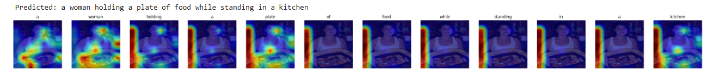
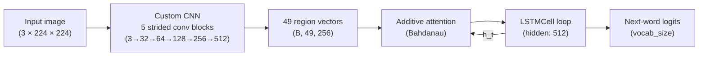
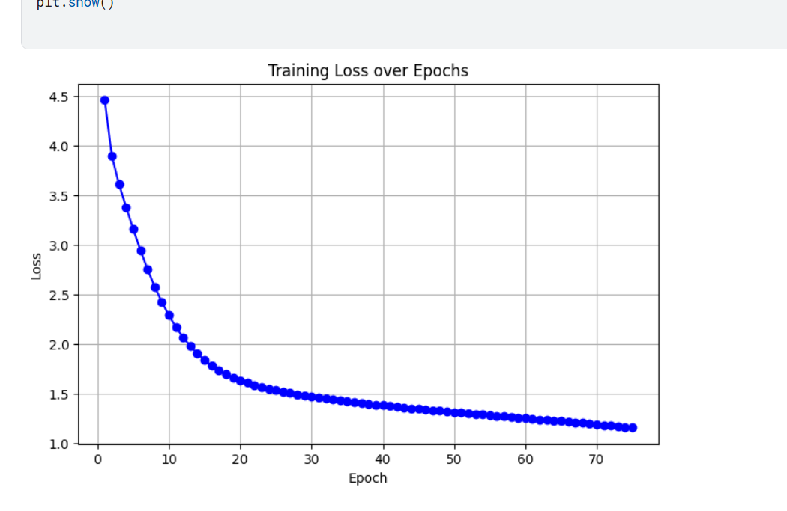
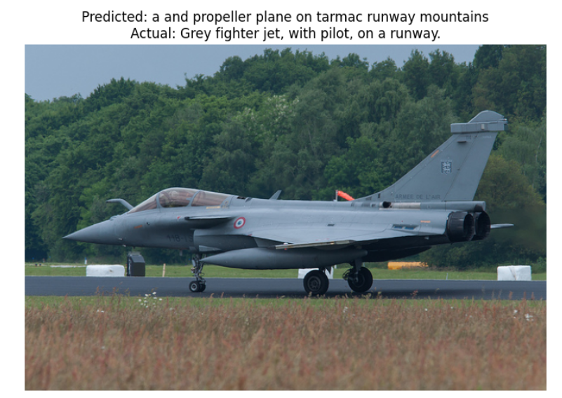
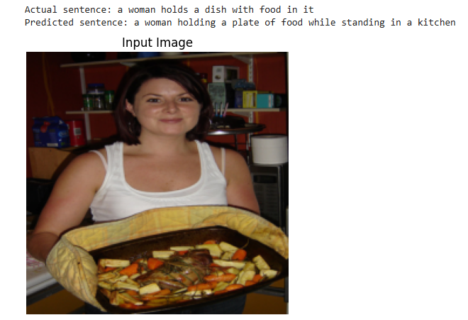
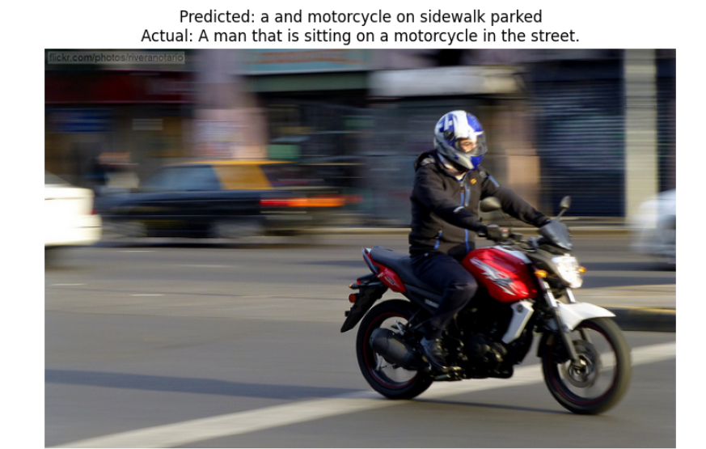
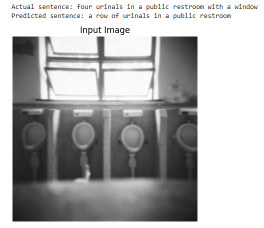
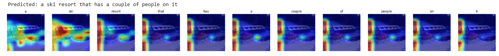

# Visual-Semantic-Encoder

**Image captioning with a CNN encoder and LSTM decoder with soft attention, trained on MS COCO 2017.**


<p align="center">
  
  <br>
  <em>Per-word attention heatmaps produced by the model — brighter regions show where the model focuses while generating each word.</em>
</p>

---

## How It Works

The system follows a standard encoder–decoder architecture with additive (Bahdanau) attention:



1. **Encoder** — A 5-layer strided convolutional network (trained from scratch, not a pretrained backbone) processes a 224×224 RGB image into a 7×7 grid of 512-dimensional feature maps, projected to 256 dimensions. This yields **49 spatial region vectors**.
2. **Attention** — At each decoding step, an additive (Bahdanau) attention module scores each of the 49 regions against the decoder's previous hidden state, producing a softmax-weighted context vector. The attention weights are also used to generate the heatmap visualisations shown above.
3. **Decoder** — An `LSTMCell` receives the concatenation of the current word embedding and the attention context at each step, and predicts the next word via a linear output layer. Decoding uses greedy argmax (beam search is not implemented).

---

## Results

### Training Loss

The training loss (cross-entropy) over the course of training. The plot covers approximately 75 epochs, with the loss decreasing to about 1.15. This is **training loss only**; no validation curve was recorded.

<p align="center">
  
</p>

### Quantitative Results

| Metric | Score | Note |
|--------|-------|------|
| BLEU-1 | 0.39 | Reported by the author from the original run |
| BLEU-4 | 0.13 | Reported by the author from the original run |

> The exact evaluation setup of the reported run (data split, number of references, decoding strategy) is not recorded in the repository. See [Limitations](#limitations) and [docs/KNOWN_ISSUES.md](docs/KNOWN_ISSUES.md) for details.

### Sample Outputs

Sample captions generated by the model. Outputs are imperfect — dropped words and awkward phrasing are expected given the encoder is trained from scratch without a pretrained backbone.

| Sample 1 | Sample 2 | Sample 3 |
| :---: | :---: | :---: |
|  |  |  |
| *"a and propeller plane on tarmac runway mountains"* | *"a woman holds a dish with food in it"* | *"a and motorcycle on sidewalk parked"* |

<br>

| Sample 4 | Sample 5 |
| :---: | :---: |
|  |  |
| *"four urinals in a public restroom with window"* | *"a car street a and bus"* |

### Attention Heatmaps

The attention mechanism allows the model to focus on different spatial regions while generating each word. In the heatmaps below, brighter areas indicate where the model placed its focus for the corresponding word.

<p align="center">
  
  <br>
  
  <br>
  <em>Per-word attention heatmaps showing spatial focus during caption generation.</em>
</p>

---

## Design Decisions and What I Learned

I built this project to understand the encoder–decoder captioning pipeline end-to-end, from raw pixels to generated text.

**Why additive (Bahdanau) attention?**  I wanted to implement the classic attention mechanism from scratch rather than relying on a library. Bahdanau attention is straightforward to implement and produces interpretable per-word attention maps — the heatmaps above are a direct visualisation of the learned attention weights, not a separate explainability tool.

**Why a from-scratch CNN instead of a pretrained ResNet?** Using a simple 5-layer convolutional encoder meant I had to understand every part of the feature extraction pipeline. The trade-off is clear: captions are rougher than what a pretrained backbone would produce, but the learning value was high.

**What the attention maps show.** Each map is the 7×7 softmax attention distribution (49 regions), resized back to image dimensions. On good examples (like the kitchen heatmap), you can see the model shifting focus — "woman" highlights the person, "plate" highlights the object in her hands. On weaker examples, the attention is more diffuse, which lines up with the less coherent captions.

**What I'd do differently next time:**
- **Held-out evaluation**: evaluate on the COCO validation set with all five reference captions per image, which is the standard protocol.
- **Pretrained encoder**: swap the from-scratch CNN for a frozen or fine-tuned ResNet/EfficientNet backbone — this alone would likely improve BLEU scores substantially.
- **Beam search**: replace greedy decoding to find higher-probability caption sequences.
- **More metrics**: add METEOR, CIDEr, and ROUGE-L alongside BLEU.

---

## Installation

### 1. Clone the repository

```bash
git clone https://github.com/RishitModi/Visual-Semantic-Encoder.git
cd Visual-Semantic-Encoder
```

### 2. Create a virtual environment (recommended)

```bash
python -m venv venv
# Linux / macOS
source venv/bin/activate
# Windows
venv\Scripts\activate
```

### 3. Install dependencies

```bash
pip install -r requirements.txt
```

> **Note:** The original trained weights (`checkpoint_img_caption.pth`) are not included in the repository (`*.pth` is gitignored). All results shown above were produced on a different machine during the original training run.

---

## Usage

All entry points are runnable as Python modules from the repository root.

### Train the model

```bash
python -m vse.train \
    --data_dir /path/to/coco2017 \
    --save_dir runs/ \
    --epochs 60 \
    --batch_size 32
```

The training script defaults to 60 epochs; the loss plot shown above covers approximately 75 epochs. A checkpoint and a `vocab.json` file are saved to `--save_dir` after each epoch.

To resume from a checkpoint:

```bash
python -m vse.train \
    --data_dir /path/to/coco2017 \
    --save_dir runs/ \
    --resume runs/checkpoint_img_caption.pth
```

### Generate a caption for a single image

```bash
python -m vse.caption \
    --image path/to/image.jpg \
    --checkpoint runs/checkpoint_img_caption.pth \
    --vocab runs/vocab.json
```

### Visualise attention heatmaps

```bash
python -m vse.attention \
    --image path/to/image.jpg \
    --checkpoint runs/checkpoint_img_caption.pth \
    --vocab runs/vocab.json \
    --save attention_output.png
```

### Evaluate BLEU scores

```bash
python -m vse.evaluate \
    --checkpoint runs/checkpoint_img_caption.pth \
    --vocab runs/vocab.json \
    --data_dir /path/to/coco2017 \
    --num_eval 1000
```

> **Note:** This evaluates on the first `--num_eval` items of the training annotation list (not a held-out split), with a single reference caption per image and greedy decoding. See [docs/KNOWN_ISSUES.md](docs/KNOWN_ISSUES.md).

---

## Data

This project uses the [MS COCO 2017](https://cocodataset.org/) dataset. The full training split contains approximately 118,000 images, each with about 5 human-written captions.

Expected directory layout under `--data_dir`:

```text
coco2017/
├── train2017/                # Training images
│   ├── 000000000009.jpg
│   ├── 000000000025.jpg
│   └── ...
├── val2017/                  # Validation images (not used by this repo)
│   └── ...
└── annotations/
    ├── captions_train2017.json   # Captions for training images
    └── captions_val2017.json     # Captions for validation images
```

Each image can have multiple captions (typically 5). The folder names and annotation file names must match the paths expected by the code.

The original training run used 20,000+ images and 90,000+ captions from the training split. The vocabulary was built from these captions with a frequency threshold of 5, resulting in 5K+ tokens.

### Producing `vocab.json` from annotations

When you run `python -m vse.train`, a `vocab.json` is saved automatically to `--save_dir`. For inference you only need this file, not the raw annotations:

```python
from vse.data import Vocabulary
vocab = Vocabulary.load("runs/vocab.json")
```

---

## Project Structure

```text
Visual-Semantic-Encoder/
├── vse/                         # Main package
│   ├── __init__.py
│   ├── train.py                 # Training entry point
│   ├── evaluate.py              # BLEU evaluation entry point
│   ├── caption.py               # Single-image captioning CLI
│   ├── attention.py             # Attention heatmap CLI
│   ├── models/
│   │   ├── __init__.py
│   │   ├── encoder.py           # EncoderCNN (5-layer strided conv)
│   │   ├── attention.py         # Bahdanau additive attention
│   │   ├── decoder.py           # DecoderWithAttention (LSTMCell)
│   │   └── combined_model.py    # CombinedModel (encoder + decoder)
│   ├── data/
│   │   ├── __init__.py
│   │   ├── vocab.py             # Vocabulary (build, save, load)
│   │   └── dataset.py           # CocoDataset, CaptionCollator
│   └── utils/
│       ├── __init__.py
│       ├── config.py            # Default hyperparameter dataclass
│       ├── checkpoint.py        # Save / load checkpoints
│       ├── visualization.py     # Caption generation & attention overlay
│       └── evaluation.py        # BLEU-1 / BLEU-4 via NLTK
├── tests/                       # pytest test suite (CPU, no data)
├── docs/
│   ├── KNOWN_ISSUES.md          # Limitations of the original experiment
│   └── assets/                  # Moved attention-map screenshots
├── images/                      # Result images (loss curve, samples, heatmaps)
├── models/                      # Original model files (pre-refactor)
├── utils/                       # Original utility files (pre-refactor)
├── inference/                   # Original inference scripts (pre-refactor)
├── requirements.txt
├── .gitignore
└── README.md
```

---

## Features

- End-to-end image captioning: raw image → generated English caption.
- Bahdanau (additive) soft attention with per-word heatmap visualisation.
- Data preprocessing pipeline: tokenisation, vocabulary construction (frequency thresholding), numericalisation, and padded collation.
- Checkpoint save/resume for training.
- Vocabulary serialisation to JSON for inference without raw annotations.
- CLI entry points for training, evaluation, captioning, and attention visualisation.

---

## Evaluation Metrics

The code computes BLEU-1 and BLEU-4 using NLTK's `corpus_bleu`. These n-gram precision metrics measure how closely the generated captions match reference captions, with BLEU-4 requiring matching 4-gram phrases and thus being a stricter measure.

---

## Limitations

See [docs/KNOWN_ISSUES.md](docs/KNOWN_ISSUES.md) for a full list. Key points:

- The reported BLEU scores (BLEU-1 = 0.39, BLEU-4 = 0.13) are from the author's original run; the exact evaluation setup is not recorded in the repository.
- The evaluation script runs on training data, not a held-out split.
- Only training loss is plotted (no validation curve).
- The encoder is trained from scratch (no pretrained backbone).
- Decoding is greedy only.

---

## Roadmap

- [ ] Beam search decoding
- [ ] Pretrained ResNet / EfficientNet encoder (transfer learning)
- [ ] Held-out evaluation on COCO val2017 with all 5 reference captions per image
- [ ] CIDEr and METEOR metrics
- [ ] Transformer-based decoder
- [ ] Web demo for real-time captioning

---

## Learning Outcomes

- Implemented an encoder–decoder architecture with attention from scratch.
- Understood how additive attention works and how to visualise it as heatmaps.
- Extracted spatial image features using a custom CNN.
- Generated text sequences with an LSTMCell decoder and teacher forcing.
- Evaluated caption quality using BLEU metrics.
- Built an end-to-end data pipeline (COCO JSON → tokenisation → numericalisation → batched DataLoader).

---

## Resume / Blurb

> Developed an end-to-end image captioning system using a CNN encoder and LSTM decoder trained on MS COCO with 20,000+ images and 90,000+ captions. Integrated Bahdanau attention to improve caption relevance and visualise word-level focus regions, strengthening computer vision–NLP alignment. Built an end-to-end data preprocessing pipeline with vocabulary construction (5K+ tokens), optimised with cross-entropy loss; achieved BLEU-1: 0.39 and BLEU-4: 0.13.

---

## Built By

Rishit Modi
